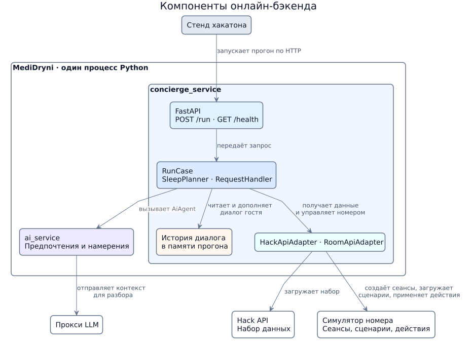

# MediDryni · Номер, который знает гостя

Решение кейса 2 для Sain × Школы 21. К заселению гостя партнёрский отель сна готовит персональный сценарий на вечер, ночь и утро. В приложении гость видит расписание, меняет настройки номера вручную или просит об этом текстом и голосом.

## Запуск

### Вход на финальный показ

1. Откройте приложение и введите код показа из `DEMO_ACCESS_CODE`. Если в поле «Код набора» уже стоит финальный код, просто нажмите кнопку входа. При необходимости код можно ввести вручную. [Открыть приложение](https://team10.hack.be-healthy.tech/) · [Код показа в start.sh](start.sh)
2. После входа приложение открывает единственный финальный заезд. При первом входе сервер готовит сценарий по профилю гостя. Каждый браузерный профиль получает свою комнату, при обновлении страницы сохраняются её настройки и переписка.
3. На главной раскройте карточку периода, чтобы посмотреть его план. Ползунок под часами перематывает демо-время при отпускании. В ручном режиме изменения сохраняются при смене периода или выходе с экрана. В «Умной настройке» можно, например, попросить «Сделай на градус прохладнее» или «Поставь будильник на утро». Для голосового ввода на телефоне откройте приложение по HTTPS и разрешите доступ к микрофону.

### Развёртывание

При push в `main` или ручном запуске GitHub Actions собирает React-клиент на Node.js 22 и отправляет сборку вместе с Python-кодом на стенд. Для деплоя нужен секрет репозитория `STAND_SSH_KEY`. Стенд устанавливает зависимости из `requirements.txt` для Python 3.11 и запускает из корня репозитория одну команду. [Workflow деплоя](.github/workflows/deploy.yml)

```sh
sh start.sh
```

Один процесс FastAPI обслуживает и браузер, и API на `0.0.0.0` и порту из `PORT` (по умолчанию 8000). Для проверки доступности используйте `GET /health`, ответ — `{"status":"ok"}`. Адрес API организаторов и командный токен поступают из `HACK_API_URL` и `HACK_TEAM_TOKEN`. Для чата и голоса приложение читает серверные `LLM_BASE_URL`, `LLM_API_KEY` и `LLM_MODEL`.

### Локальный запуск и тесты

Для запуска нужны Python 3.11 и Node.js 22.12+. Из корня репозитория выполните следующие команды.

```sh
python3.11 -m venv .venv
. .venv/bin/activate
python -m pip install -r requirements.txt
npm --prefix web ci
npm --prefix web run build
export HACK_API_URL=https://hack-api.be-healthy.tech
export HACK_TEAM_TOKEN="$(cat secrets/api.token)"
make run
```

Откройте `http://localhost:8000/`. Для набора разработки укажите `case2-dev-v1` и выберите заезд. Когда все три переменные `LLM_*` отсутствуют, сервер использует локальную заглушку. Сценарий строится по профилю, чат возвращает отказ, голос недоступен. После истечения 45-минутного dev-прогона браузер открывает тот же заезд заново с исходным планом и пустой перепиской.

Автоматические проверки выполняются локально. Последняя команда проверяет комплектность открытого dev-набора.

```sh
make test
node --test web/src/data/staySettings.test.js web/src/screens/smart/chat.test.js
PYTHONPATH=src .venv/bin/python tools/evaluate_dev_run.py
```

### Архитектура

React обращается к FastAPI через `/api/v1`. При входе через `POST /api/v1/run_client` сервер получает набор, рассчитывает общий исходный план и открывает отдельный final-прогон и сеанс заезда для каждого нового клиентского ключа. Изменения расписания, история и часы принадлежат комнате. Финальный прогон действует до 23:59 МСК 22 ноября. [Правила финала](docs/case/for-teams-final.md) · [Контракты демо](docs/plan/demo.md)

Оба режима используют `ai_service` для разбора предпочтений и просьб. В `concierge_service` планировщик составляет расписание, а обработчик просьб проверяет команды по каталогу устройств и сверяет исполнение с ответом симулятора. В голосовом режиме распознанная просьба попадает в общий чат, готовый ответ можно услышать и прочитать.

Диаграмма показывает путь онлайн-проверки. Стенд вызывает `POST /run` с телом `{"case":2,"dataset_code":"…"}` и заголовком `Authorization: Bearer <run_token>`. Сервер возвращает сеансы заездов и ответы на просьбы одним JSON. [Обработка /run](docs/plan/run_flow.md) · [Исходник диаграммы](docs/plan/c2-component.puml)



### Документация

| Документ | Что в нём искать |
|---|---|
| [Описание кейса](docs/case/Кейс_2.pdf) и [инструкция для команд](docs/case/Инструкция_для_команд.pdf) | Правила работы номера, условия оценки, требования к стенду и сдаче. |
| [Общий план](docs/plan/plan.md) | Что должно быть готово к онлайн-проверке и к финальному показу. |
| [Архитектурные решения](docs/plan/decisions.md) | Почему разделены понимание и исполнение просьб, как устроены память диалога и обработка сбоев. |
| [Обработка запроса](docs/plan/run_flow.md) | Путь от `POST /run` до сценария заезда, действия в комнате и ответа стенду. |
| [Этапы реализации](docs/realization/steps.md) | Работы и критерии приёмки для каждого из семи этапов. |
| [Контракт AiAgent](docs/contracts/ai_agent.md) и [OpenAPI организаторов](docs/contracts/openapi.json) | Типы на границе двух пакетов и HTTP-контракты внешних сервисов. |
| [Dev-набор](docs/data/dataset.json) и [отчёт этапа 6](docs/realization/stage6-review.md) | Данные с эталоном, измерения полного прогона и разбор расхождений. |
| [Репетиция демо](docs/realization/demo_steps.md#75-репетиция-показа) | Время первого входа, проверка пяти комнат, пик памяти и проверка голоса. |

## Роли

| Участник | Вклад |
|---|---|
| grimmhyd (Git: Krovenmor) | Спроектировал бэкенд, разработал concierge-сервис, интеграцию с симулятором и React-клиент по макетам дизайнера. |
| czechtor (Git: lillyroot) | Разработала AI-сервис для извлечения предпочтений и интерпретации просьб. |
| melaquis | Анализ кейса, исследование и текст выступления. |
| tyberfer | UX/UI и дизайн презентации. |

## ИИ

Команда анализировала кейс, проектировала бэкенд и интерфейс, выбирала варианты реализации и разбирала расхождения с эталоном. При разработке использовали Codex Sol, Deepseek 4.1 и Kimi K3.1 Pro. Для ревью также использовали Astra. Codex помогал писать код, тесты и диагностировать сбои. Во время прогона GPT-6 Luna извлекает предпочтения и распознаёт намерение гостя. Действия рассчитывает Python-код, проверяет по схеме устройства и сверяет с ответом симулятора. Для голосовых сообщений используются `gpt-transcribe` и `tts-1`. OpenRouter использовался в локальных экспериментах с моделью.

## Источники

Описание кейса, OpenAPI, набор разработки и исходный шаблон деплоя предоставлены организаторами для хакатона. Эталон dev используется при оценке качества. Команда разработала прикладной код во время хакатона. Сторонний код, который команда подключила самостоятельно, перечислен в зависимостях ниже. [Материалы кейса](docs/case) · [Контракт Hack API](docs/contracts/openapi.json)

- **Бэкенд.** FastAPI, Pydantic и jsonschema распространяются под MIT, Uvicorn и HTTPX — под BSD-3-Clause, tzdata и python-multipart — под Apache-2.0. [Версии зависимостей](requirements.txt)
- **Клиент.** Интерфейс использует React и React DOM, для сборки команда выбрала Vite и его React-плагин. Все четыре пакета распространяются под MIT. [Зависимости клиента](web/package.json) · [Зафиксированные версии](web/package-lock.json)
- **Шрифты.** Montserrat, Poiret One и Train One поставляются с клиентом по SIL Open Font License 1.1. [Тексты лицензий](web/public/licenses)
- **Анимация голоса.** Визуальным референсом для движения света служил пример Cameron Knight. В клиенте текстура света из макета деформируется на Canvas. [Референс на CodePen](https://codepen.io/cameronknight/pen/ogxWmBP) · [Реализация эффекта](web/src/screens/smart/VoiceLight.jsx)

## Журнал решений

1. Согласовали контракт `AiAgent`, чтобы работать параллельно. grimmhyd разрабатывал concierge и проверял его с моком, а czechtor реализовывала извлечение предпочтений и разбор просьб в `ai_service`. На стенде оба пакета работают в одном процессе. Если AI понадобится развернуть отдельно, concierge сможет обращаться к нему через сетевой адаптер с тем же контрактом.
2. Доверили модели разбор просьбы, а concierge — весь план действий в Room API. Например, для «выключи всё» модель возвращает `all_off`, и дальше concierge сам проверяет и выполняет команды для всех устройств. В тесте каталог запрещает нулевую громкость, поэтому concierge отклоняет план до первой команды и свет остаётся включённым. Для допустимого плана одного распознанного намерения хватает на все устройства.
3. Общий batch просьб мешал бы учитывать результат предыдущей реплики. Поэтому каждую просьбу интерпретируем отдельно, по одному диалогу на гостя.
4. Два ответа на одну двухчастную просьбу расходились с эталоном dev. Объединили входные реплики и отвечаем один раз по итогам действия.
5. Короткие ответы модели обрывались при извлечении предпочтений. Привязали лимит генерации к числу профилей и дали на подготовку до десяти минут внутри общего дедлайна.
6. Домашний свет для чтения попадал в ночной сценарий. Разделили настройки дома, сна, подъёма и фактически применённые настройки прошлых заездов, сохраняя ссылки на источники.
7. Для «сделай как вчера» пробовали помечать в сводке настройки, применённые в прошлом заезде. Та же dev-просьба снова получила отказ. Добавили проверку конкретной реплики, где агент подтвердил значения. На этой просьбе совпали все четыре поля. [Разбор эксперимента](docs/realization/stage6-review.md#точечная-проверка-сделай-как-вчера)
8. При моделировании сетевого сбоя подтверждение операции могло потеряться. Повторяем чтение и идемпотентное создание сеанса. Действия и загрузку сценария отправляем один раз.
