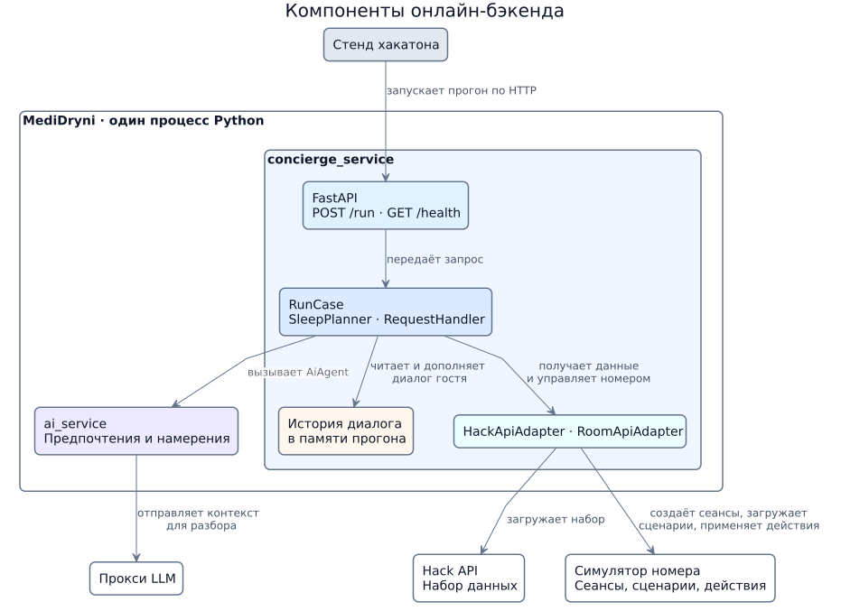

# План реализации кейса 2 «Номер, который знает гостя»

## 1. Цель и ограничения

Реализовать backend, который:
- по `POST /run` получает весь dataset через `GET /case/2/getData` и возвращает один JSON `{stays, requests}` без внешней обёртки;
- для каждого заезда строит сценарий R1–R8, загружает его в отдельный сеанс симулятора;
- для каждой просьбы открывает отдельный сеанс, выполняет допустимые действия и возвращает 1–2 реплики `done|refused`;
- учитывает профиль, ленту и порядок диалога каждого пользователя; структурированные данные приоритетнее текста ленты;
- после готовности online backend — предоставить клиенту API заселения, состояния номера и диалога для offline/final-демонстрации.

Ограничения стенда: **Python 3.11**, один контейнер, 1 CPU, 512 МБ, только `/tmp` доступен на запись, состояние контейнера эфемерно, внешняя сеть закрыта, кроме Hack API и LLM proxy. На `/run` одна попытка и 45 минут. LLM: 30 запросов/мин и 300 тыс. токенов/сутки. Построение сценария до 10 секунд — второстепенное пожелание заказчика, а не критерий готовности.

Главный приоритет — корректность и качество `x = 0,7 × C + 0,3 × S`; оптимизации времени не должны снижать качество сценариев и просьб.

## 2. Архитектурные решения



Исходник диаграммы: [c2-component.puml](c2-component.puml).

**Модульный монолит в одном процессе.** Два сетевых сервиса не нужны: стенд запускает один `start.sh`, а внутренний HTTP только добавил бы задержки, точки отказа и расход памяти. Границы модулей сохраняются через пакеты, порты и typed-контракт; разделение на процессы возможно позже без переноса бизнес-правил.

Названия: `concierge_service` вместо универсального `core-service` — модуль оркестрации заездов, просьб и комнаты; `ai_service` — NLU и извлечение знаний из ленты. В путях используются `_`, поскольку это Python-пакеты.

**Стек:** существующие FastAPI + Uvicorn, Pydantic на границах, `httpx.AsyncClient` для Hack API, симулятора и OpenAI-compatible `/chat/completions`. Без LangChain/LlamaIndex, ORM, брокера, Redis/PostgreSQL и DI-фреймворка. DI — ручная сборка в composition root. Доменные модели — `dataclass`/Enum, время — `datetime` + `zoneinfo`; пакет `tzdata` фиксируется в `requirements.txt`, чтобы IANA-зоны были доступны в `python:3.11-slim`.

**LLM не управляет устройствами.** Она контекстно интерпретирует просьбы, возвращает структурированные `intent + slots` и извлекает подсказки предпочтений с источниками. Детерминированный код вычисляет сценарии R1–R8, проверяет диапазоны, формирует patch устройств, вызывает симулятор и выбирает `done|refused`. Ответы пользователю собираются из заранее заданных шаблонов с фактами выполненных действий; для медицинских и посторонних просьб используются фиксированные отказы без медицинских рекомендаций. Это уменьшает галлюцинации, токены и время прогона.

**Качество сценария важнее 10 секунд.** В online MVP AI всегда анализирует ленту и историю диалога для извлечения предпочтений — один раз на пользователя в рамках `/run`, независимо от заполненности профиля. Core ждёт результат в рамках обычного timeout и общего `/run` deadline; отдельного агрессивного soft deadline нет. Результат переиспользуется для заездов пользователя. Оптимизация с пропуском AI откладывается до готовности online и проверки её влияния на качество на dev. Сценарий загружается один раз после разрешения предпочтений. Время 10 секунд измеряется как вторичная метрика.

**Приоритет предпочтений: профиль → AI hints → дефолты.** `PreferenceResolver` объединяет данные по каждому параметру R1–R8: явно заданное структурированное значение приоритетнее противоречащего hint, hints дополняют недостающие сведения, а для оставшихся неизвестными параметров применяются заранее заданные детерминированные дефолты. Отсутствие сведений — штатная ситуация, в том числе после успешного ответа AI без полезных hints. При ошибке/timeout AI используются профиль и те же дефолты. Дефолты согласуются с R1–R8 и каталогом устройств, фиксируются в коде и проверяются на dev; `reference` не используется во время выполнения planner'ов.

**Контекст диалога — in-memory** в одном Uvicorn worker; этого достаточно для последовательной обработки online `/run`. Отдельное demo-состояние добавляется на offline/final-этапе. Внешняя БД на стенде недоступна, а персистентность между деплоями не требуется. Хранилище скрыто за портом, чтобы позже заменить реализацию.

## 3. Структура и зависимости

```text
services/
  concierge_service/
    cmd/api/main.py          # только создание ASGI app
    di/container.py          # конфигурация и ручная сборка зависимостей
    transport/http/          # online: /run, /health; позже: demo API
    domain/                  # модели, R1–R8, SleepPlanner, ActionPlanner
    ports/
      ai.py                  # AIAgent + DTO входа/выхода порта
      hack_api.py
      room.py
      store.py
    service/
      run_case.py            # оркестрация, без доменных правил
      preference_resolver.py # профиль + AI hints + дефолты -> ResolvedPreferences
      request_handler.py
      reply_composer.py
      demo.py                # offline/final, после online MVP
    infra/                   # HackAPI, RoomAPI, in-memory store
  ai_service/
    domain/                  # внутренние модели AI
    service/
      agent.py               # реализация AIAgent из concierge_service
      ...                    # prompt builder, batching, post-validation
    infra/llm_client.py      # LLM proxy, JSON-ответы, timeout/retry
tests/                         # unit, integration, contract
requirements.txt             # единственный набор зависимостей deployable app
start.sh                     # запуск concierge_service.cmd.api.main:app
```

`transport -> application service -> domain`; `infra` и `ai_service` реализуют порты application layer. **Домен, прикладные сервисы и порты `concierge_service` не импортируют `ai_service`.** Зависимость направлена внутрь: `ai_service -> порт concierge_service`. Composition root остаётся в `concierge_service/di/container.py`: он импортирует конкретные реализации обоих модулей и внедряет зависимости в `RunCase` и `RequestHandler`; `cmd` запускает приложение через эту сборку. У внутреннего `ai_service` нет `cmd/api` и `transport`: они имитировали бы отдельный сервис без практической пользы.

Отдельный `contracts/` не требуется: это не общий контракт равноправных сервисов, а порт, определяемый потребителем. Он фиксируется **в коде**, вместе с DTO, чтобы `concierge_service` не зависел от моделей AI:

```python
# concierge_service/ports/ai.py

class AIAgent(Protocol):
    async def extract_preference_hints(
        self, items: Sequence[ProfileContext]
    ) -> Sequence[PreferenceHints]: ...

    async def interpret_request(
        self, item: RequestContext
    ) -> RequestInterpretation: ...
```

`RequestInterpretation` содержит `record_id`, **один** из 19 intent и типизированные slots для всей записи: по кейсу даже две реплики вместе выражают одно намерение. Он не содержит готовые `/action` и финальные `response_class`. `ActionPlanner` превращает интерпретацию в ноль или несколько `PlannedAction {device_id, values}`, а `RequestHandler` валидирует весь план, выполняет его в фиксированное время просьбы и возвращает 1–2 replies в порядке входных реплик. Неизвестные ID/intent/поля отклоняются. Внешний источник истины — `docs/contracts/openapi.json`; FastAPI публикует OpenAPI для собственного demo API.

Начальные гипотезы resolver'ов для особых intent (это наши решения, а не дословные правила кейса):
- `like_home` — устойчивые домашние предпочтения: структурированный профиль приоритетнее противоречащей ленты;
- `like_yesterday` — релевантные прошлые настройки из истории пользователя, а не просто текущий профиль;
- `going_to_bed`, `woke_up` — переиспользование соответствующих sleep/wake-настроек `SleepPlanner`, без повторного вызова LLM;
- `all_off` и другие составные intent — один или несколько device patch согласно `dataset.intents[].description` и каталогу устройств;
- `medical`, `out_of_scope`, `invalid_value` — пустой план действий и `refused`.

Точная семантика resolver'ов сверяется с описаниями intent и dev reference. Приоритет профиля относится к устойчивым предпочтениям и не заменяет историю для `like_yesterday`. Если данных недостаточно, настройки не выдумываются: fallback выбирается по dev reference; для небезопасного/неопределённого действия — отказ.

## 4. Основные потоки

### `/run`

1. Проверить `case == 2` и Bearer token; один раз загрузить dataset с тем же token.
2. Построить индексы пользователей, ленты и устройств; нормализовать timezone-aware даты. Обработка просьб одного пользователя — последовательно, разных пользователей — с ограниченным параллелизмом.
3. Для каждого пользователя один раз вызвать AI для извлечения предпочтений из ленты и истории диалога, независимо от заполненности профиля. Дождаться результата в рамках обычного timeout, объединить параметры по приоритету «профиль → hints → дефолты» и рассчитать отбой с учётом R8. При ошибке/timeout AI использовать профиль и дефолты; успешный ответ без нужных сведений также дополняется дефолтами.
4. `SleepPlanner` построить шаги R1–R8 только из каталога устройств; проверить интервал `[check_in_at, target_wake_at]`, значения и поля. Для R1 при заселении до отбоя вечерний свет действует с `max(check_in_at, bedtime − 60 минут)` до отбоя: при позднем check-in допустимо меньше 60 минут, отбой ради полного часа не переносится. При заселении в момент отбоя или позже интервал R1 не создаётся, применяются настройки текущей фазы сценария. Все даты сериализовать в ISO 8601 с явным offset, не `Z`; учесть R6 и то, что таймер звука не выключает его автоматически. Создать stay session и загрузить scenario.
5. Для каждой просьбы создать request session и вызвать AI с текущими 1–2 репликами и историей только её пользователя. AI возвращает один intent для всей записи. `ActionPlanner` по интерпретации, `initial_state`, профилю и ленте строит список действий; после проверки `RequestHandler` выполняет его в фиксированное время просьбы, сохраняет незатронутые поля и после ответа пополняет контекст пользователя. При невалидном AI-ответе — один retry, затем deterministic fallback или безопасный `refused`, но не пропуск всей записи без анализа.
6. Для `out_of_scope`, `medical`, недопустимых значений и ошибок действия — `refused` с причиной; `done` — после успешного действия либо если требуемое состояние уже достигнуто. Тексты формировать шаблонами без диагнозов, лекарств, медицинских обещаний и советов вне правил сна; отель при упоминании называть только «партнёрский отель сна».
7. Проверить итог локальной схемой `Case2Answers`, вернуть HTTP 200. Ошибку одной записи изолировать, чтобы не потерять весь набор; `/case/2/validate` в online/final не вызывать.

### Demo client — только после готовности online backend

Эти endpoint'ы относятся к offline/final-демонстрации и не входят в критический путь online MVP:

- `GET /api/stay/current` — пользователь, сценарий и `session_id` после `/run`;
- `GET /api/room/state?at=...` — состояние через симулятор;
- `POST /api/room/messages` — реплика и виртуальное время; ответ содержит replies и новое состояние;
- `GET /api/home-plan` — опциональный экран «продолжение дома» на основе уже извлечённых настроек.

`DemoService` переиспользует `SleepPlanner` и `RequestHandler`; отдельной бизнес-логики для клиента не создавать.

## 5. Этапы реализации

### Online MVP — приоритет до зачётного `/run`

1. **Каркас и вертикальный срез.** Пакеты, config, DI, typed domain/ports, HTTP-клиенты, `/health`, `/run`, локальная проверка ответа. Сначала проверить один stay/request на mocks, затем полный dev-набор до `validate: true`.
2. **Сценарии заезда.** Извлечение предпочтений через LLM для каждого пользователя, объединение по приоритету «профиль → hints → дефолты», deterministic R1–R8, R8 через `zoneinfo`, генератор и валидатор шагов, загрузка в симулятор. Отсутствующие сведения заполняются дефолтами; при ошибке/timeout AI сценарий строится по профилю и дефолтам. R1 допускает сокращённый вечерний интервал при позднем check-in без переноса отбоя. Сверка с `reference.stays` и локальный подсчёт S по журналам сценариев.
3. **Просьбы и AI.** Все 19 intent, slots, контекст предыдущих реплик, strict JSON parse с одной повторной попыткой; `max_tokens` не меньше ожидаемого ответа +1000 скрытых reasoning tokens; `ActionPlanner` и resolver'ы особых intent, составные действия, отказы и шаблоны. Сверка `/room/{session_id}/log` с `reference.requests`, подсчёт C с допусками кейса и `medcheck` текстов.
4. **Готовность к online.** Начальная LLM concurrency 4, rate limiter с учётом retry, timeouts и общий deadline. Retry для GET и идемпотентного `POST /room/session`; LLM 429 — с `Retry-After`/backoff; не повторять неоднозначно выполненный `action`/`scenario`. Полный dev-прогон, проверка памяти/времени, запуск через `start.sh` и deploy. Только после этого online backend считается готовым.

### Offline/final — после стабилизации online

5. **Demo API и клиент.** Сохранение final stay/session в memory-store, клиентские endpoint'ы и UI на общем `SleepPlanner`/`RequestHandler`. До готовности online MVP сюда время не выделять.

## 6. Надёжность и критерии готовности online MVP

- Unit: границы устройств, каждое R1–R8, поздний check-in с сокращённым R1 без переноса отбоя, явное выключение звука, переходы даты/часовые пояса, приоритет «профиль → hints → дефолты», `like_home`/`like_yesterday`, sleep/wake-настройки, один intent на 1–2 реплики, составные действия, сохранение полей, отсутствие нужных данных и все классы отказов.
- Contract/integration: mocked Hack API, Room API и LLM; извлечение предпочтений независимо от заполненности профиля и переиспользование результата для заездов пользователя; успешный ответ AI без полезных hints, повреждённый/неполный JSON LLM, timeout с использованием профиля и дефолтов, 429, ошибка симулятора; один сбой не обнуляет остальные записи.
- E2E на dev: создать прогон через `POST /runs`, использовать `run_token` для локального `/run`, а `run_id` — при создании room-сессий; `/run` возвращает 200 и полный `{stays, requests}`, затем `validate` с `HACK_TEAM_TOKEN` даёт `valid == true`. Все уникальные тексты ответов пройти через `medcheck` с учётом 1 запроса/60 секунд; отдельно сравнить результат с reference — `validate` не считает баллы. `reference` доступен только dev-evaluator и никогда не передаётся в planner'ы или LLM.
- Бюджет: сначала качество C/S, затем измерение времени сценария как вторичной метрики без целевого отсечения 10 секунд. Для просьб — ограниченное число вызовов, контроль tokens/latency и rate limit; полный online-набор выполняется с запасом до 45 минут.
- Безопасность: не логировать token, dataset, реплики, ответы и URL с `dataset_code`; только технические события, длительность и HTTP status. Секреты исключительно из env.
